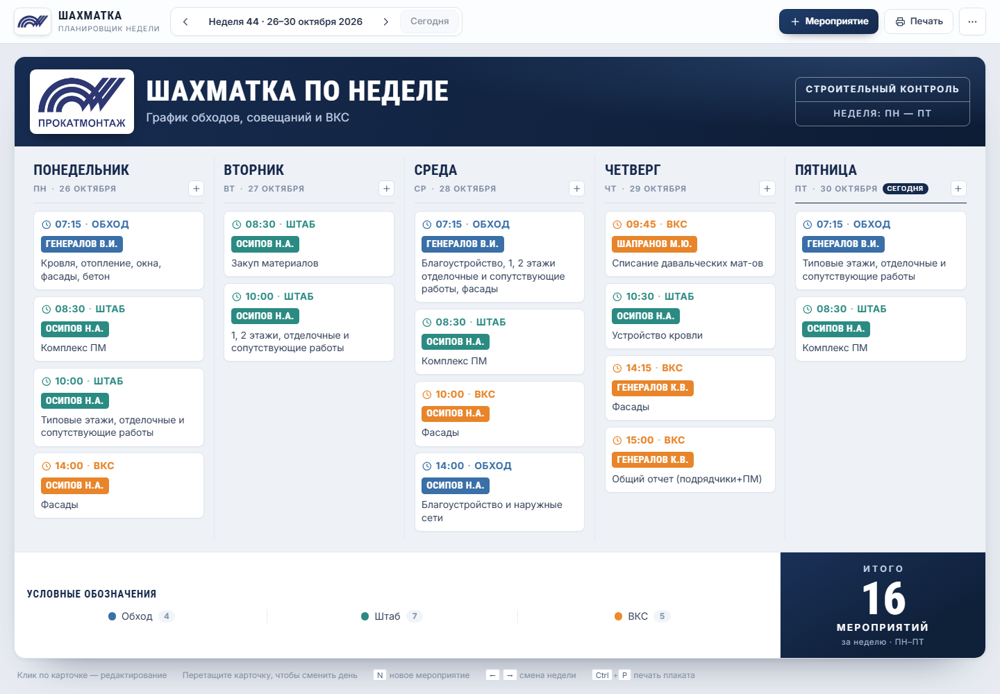
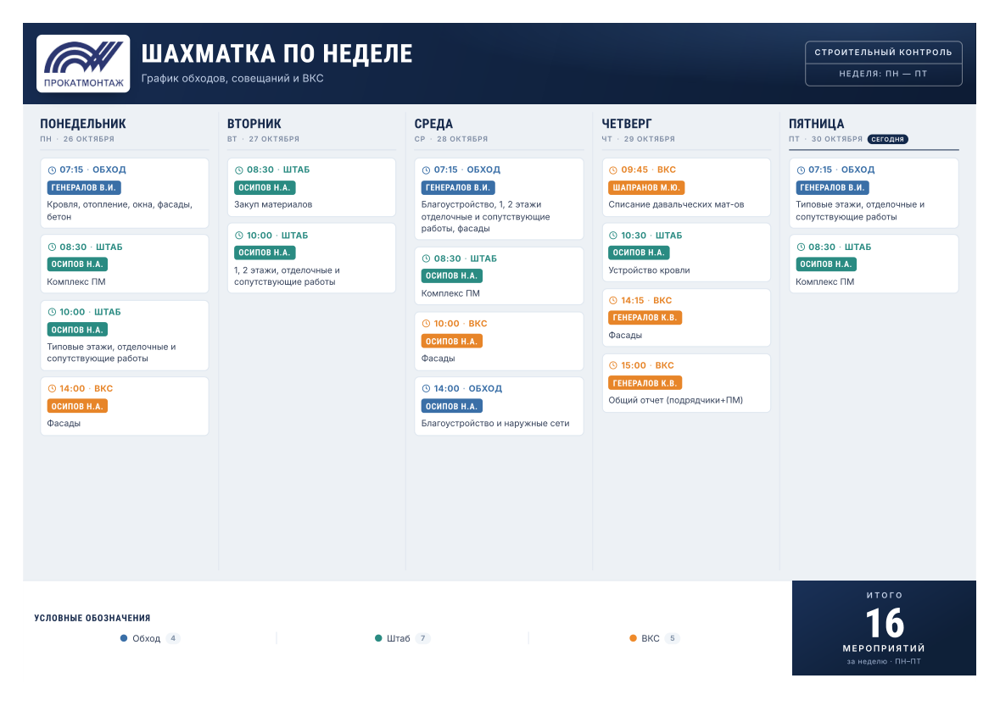

# Шахматка по неделе

Планировщик мероприятий строительного контроля: обходы, совещания и ВКС на неделю.
Одностраничный статический сервис в стиле строительной «шахматки» — без сборки,
без бэкенда, готов к публикации на GitHub Pages.



## Возможности

- **Неделя как плакат** — пять рабочих дней (при желании семь), карточки мероприятий
  с временем, типом, ответственным и описанием.
- **Добавление и редактирование** — форма с типом (обход / штаб / ВКС), днём и временем.
- **Drag & drop** — карточку можно перетащить на другой день недели.
- **Итоги автоматически** — общее количество мероприятий и разбивка по типам.
- **Печать и PDF** — `Ctrl+P` печатает только плакат: A4 горизонтально, без интерфейса.
- **Сохранение** — данные живут в `localStorage` браузера, ничего не уходит на сервер.
- **Обмен ссылкой** — «Поделиться» кодирует план в ссылку, по ней план открывается у коллеги.
- **Экспорт / импорт JSON** — резервная копия или перенос между устройствами.
- **Копирование прошлой недели** — собрать новый план из повторяющихся мероприятий.
- **Настройки плаката** — заголовок, подзаголовок, организация, показ субботы и воскресенья.
- **Отмена действий** — удаление, очистка недели и импорт отменяются кнопкой в уведомлении.
- **Адаптивность** — на телефоне дни выстраиваются друг под другом.
- **Независимость от сети** — шрифты лежат локально, внешних CDN нет.

## Как выглядит печать



Печать настроена на **A4 горизонтально**, поля 7 мм: на листе остаётся только плакат —
шапка, сетка дней и итоговый блок. Если мероприятий очень много, план может занять
два листа; в диалоге печати можно включить «Масштаб: по размеру страницы».

## Публикация на GitHub Pages

### Вариант 1. Через GitHub Actions (рекомендуется)

1. Создайте репозиторий и скопируйте в его **корень** содержимое этой папки
   (`index.html`, `assets/`, `preview*.png`, `.nojekyll`,
   `.github/workflows/pages.yml`).
2. В репозитории: **Settings → Pages → Build and deployment → Source: GitHub Actions**.
3. Сделайте коммит в ветку `main` — workflow соберёт и опубликует сайт.
4. Через минуту страница будет доступна по адресу
   `https://<логин>.github.io/<репозиторий>/`.

### Вариант 2. Без Actions

**Settings → Pages → Source: Deploy from a branch → Branch: `main` / `root`** — сайт
развернётся прямо из корня репозитория. Файл `.nojekyll` уже добавлен, чтобы GitHub
не обрабатывал статику через Jekyll.

## Локальный запуск

Сборка не нужна — достаточно отдать папку любым статическим сервером:

```powershell
# из папки проекта
python -m http.server 8080
# затем откройте http://localhost:8080
```

Можно открыть и просто `index.html` двойным кликом — всё работает, кроме буфера обмена
(кнопка «Поделиться» в этом случае покажет ссылку в адресной строке).

## Горячие клавиши

| Клавиша | Действие |
| --- | --- |
| `N` | новое мероприятие |
| `←` / `→` | предыдущая / следующая неделя |
| `Ctrl` + `P` | печать плаката |
| `Esc` | закрыть форму |
| `Enter` / `Space` на карточке | открыть редактирование |

## Структура проекта

```
index.html                   — разметка страницы и SVG-иконки
assets/styles.css            — оформление плаката, адаптив, стили печати
assets/app.js                — состояние, рендер, редактор, импорт/экспорт
assets/logo.png              — логотип для шапки плаката
assets/logo-mark.png         — знак логотипа для панели управления
assets/logo-mark-white.png   — белый знак (резерв, для тёмного фона)
assets/favicon.png           — иконка сайта
assets/fonts.css             — подключение локальных шрифтов
assets/fonts/*.woff2         — Roboto Condensed + Inter (кириллица и латиница)
preview.png                  — скриншот для README
preview-print.png            — вид печатной версии
.github/workflows/pages.yml  — автодеплой на GitHub Pages
```

## Данные и хранение

Состояние хранится в `localStorage` под ключом `shahmatka.weekplan.v1`:

```json
{
  "current": "2025-05-12",
  "settings": {
    "title": "Шахматка по неделе",
    "subtitle": "График обходов, совещаний и ВКС",
    "org": "Строительный контроль",
    "note": "Неделя: ПН — ПТ",
    "showWeekend": false
  },
  "weeks": {
    "2025-05-12": [
      {
        "id": "abc123",
        "day": 0,
        "time": "07:15",
        "type": "walk",
        "person": "Генералов В.И.",
        "desc": "Кровля, отопление, окна, фасады, бетон"
      }
    ]
  }
}
```

- `day` — 0 = понедельник … 6 = воскресенье;
- `type` — `walk` (обход), `staff` (штаб), `vks` (ВКС);
- ключ недели — дата её понедельника в формате `ГГГГ-ММ-ДД`.

При первом открытии текущая неделя заполняется демонстрационным планом
из 16 мероприятий — его можно очистить через меню «Очистить неделю».

## Настройка под себя

- **Типы мероприятий** — массив `TYPES` в начале `assets/app.js`. Цвета типов —
  переменные `--blue`, `--teal`, `--orange` в `assets/styles.css`.
- **Демо-план** — функция `demoEvents()` в `assets/app.js`.
- **Формат печати** — блок `@media print` в конце `assets/styles.css`
  (`@page { size: A4 landscape; margin: 7mm; }`). Для A3 поменяйте размер страницы,
  при необходимости — масштаб печатного шрифта (`html { font-size: 11.2px; }`).
- **Логотип** — файлы `assets/logo.png` (шапка плаката), `assets/logo-mark.png`
  (панель управления) и `assets/favicon.png`. Чтобы поставить свой логотип, замените
  изображения с теми же именами; пропорции подгоняются автоматически (`object-fit: contain`).
- **Название сервиса** — блок `.brand` в `index.html` и `<title>`, а также
  заголовок/подзаголовок плаката в настройках (или в `defaultSettings()` в `assets/app.js`).

## Шрифты

Шрифты подключены локально и не требуют интернета:

- **Roboto Condensed** — Apache License 2.0 (`assets/fonts/LICENSE-RobotoCondensed.txt`);
- **Inter** — SIL Open Font License 1.1 (`assets/fonts/LICENSE-Inter.txt`).

Источник — Google Fonts, файлы разбиты на подмножества (кириллица, латиница).
Подробности — в `assets/fonts/README.md`.

## Браузеры

Chrome, Edge, Firefox, Safari — актуальные версии. Используются `<dialog>`,
`localStorage`, Clipboard API и CSS-переменные. Без JavaScript страница не работает.
